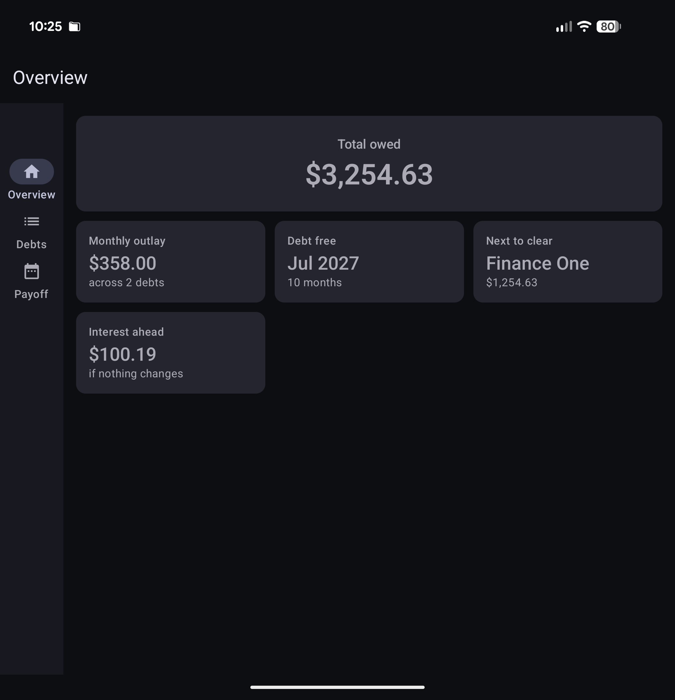
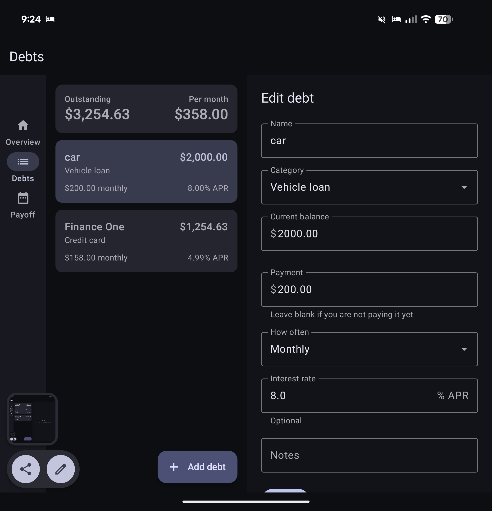
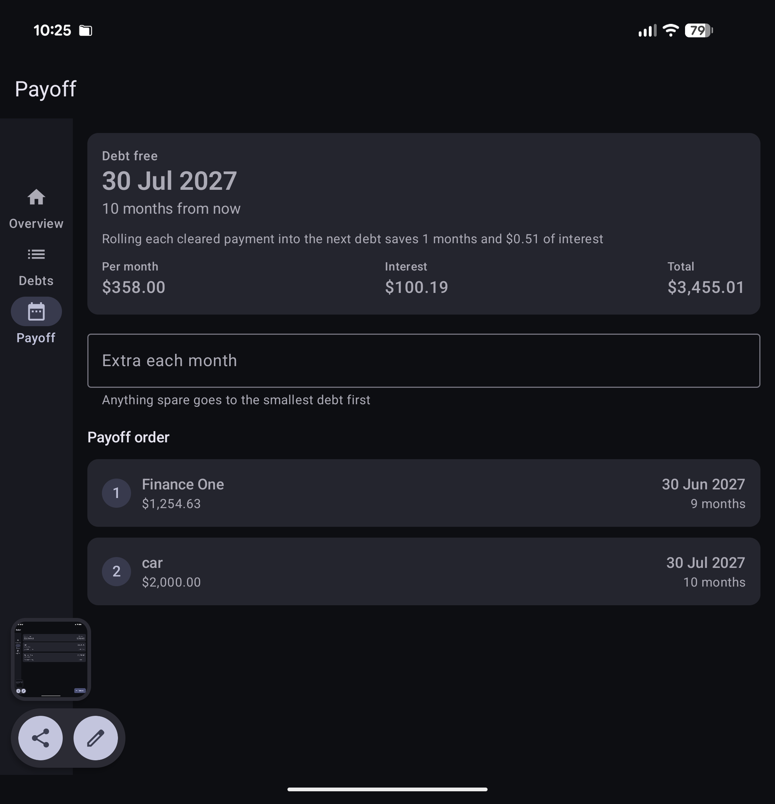
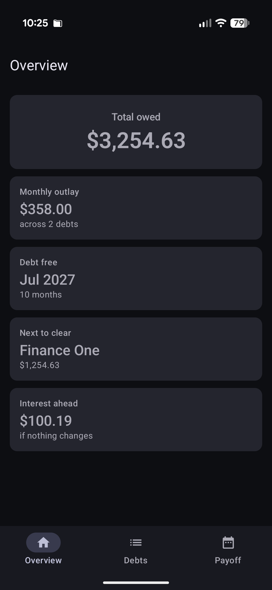

# QuietLedger for Android

A high-level balance sheet for a phone. Like a basic spreadsheet with formulas,
and considerably more reliable than one.

Built first for the Pixel Fold and written to be published, so no shortcuts
that would have to be undone later. It runs on Android 10 and newer.

**In development, close to ready.** There are no builds to download yet. Build
from source to try it. Screens may change before the first release.

## Screenshots

These show made up example data. Screens may change while the app is still in
development.

**Overview** on the unfolded inner screen:



**Debts** with the editor open beside the list:



**Payoff** order and projected dates:



**Overview** on the folded cover screen:



More are in [docs/screenshots](docs/screenshots).

## What it is for

Seeing where things stand, and getting the debt gone faster. Not detailed
record-keeping.

Everything comes in one of four ways:

| Data | How it arrives |
| --- | --- |
| Lenders and bills | Read the balance and rate off the lender's own screen, type them in |
| Retirement and investments | Fidelity positions CSV, which replaces everything on import |
| Precious metals | Parsed from the original purchase invoices, valued at cost |
| Spot prices | Looked up online, entered by hand |

Out of that come the figures that matter: net worth, what is owed, monthly
outlay, and a payoff projection that explains its own assumptions.

### The bar is "more reliable than a spreadsheet"

That is what the app has to earn, and it sets the priorities.

A spreadsheet is wrong in ways you can see, because the formula is right there in
the cell. An app hides its arithmetic, so it has to be **checkable** instead:
every derived number says where it came from. "$1,625.00 a month (52 a year over
12)". "Worth at spot" rather than "worth". "Held, at cost" when no price has been
given. "Spot is not a sale price."

It also means correctness of the aggregations outranks new features, and that a
plausible wrong number is worse than a missing one. Several decisions in
`docs/ui-backlog.md` only make sense in that light: why a partial valuation shows
nothing rather than mixing cost with market, why an unknown expense category is
left as "other" rather than guessed, and why a locked database reports being
unreadable instead of showing an empty list.

## Where it came from

QuietLedger started as a Python desktop app for Linux. That app was never
published and is retired. This is a rewrite, not a port. The user interface is
new, and what carried over is the database schema, the domain model, the debt
snowball algorithm, the tax estimator logic and the encrypted backup format.

`scripts/desktop-to-android.py` and `scripts/compare-schema.py` are left over
from moving data off the old app. Nobody else needs them.

## Status

Early but running. Encrypted database, exact money arithmetic, a Fidelity CSV
importer, a payoff engine, and three working screens: Overview, Debts, Payoff.

Not done yet: biometric unlock, recurring expenses UI, investments, savings,
precious metals, taxes, analytics.

## Decisions already made

- **Stack:** Kotlin, Jetpack Compose, Room.
- **Encryption:** SQLCipher for the database, key wrapped in the Android
  Keystore, biometric unlock with a passphrase fallback. Screenshots blocked,
  cloud backup off, auto lock when the app goes to the background.
- **Layout:** the unfolded inner screen is the primary target. The folded cover
  screen gets a condensed dashboard through Compose window size classes. A home
  screen widget shows net worth without opening the app.
- **Holdings and prices:** a weekly CSV export from Fidelity, imported through
  the standard Android file picker. No broker API, no keys, no credentials on
  the device. Direct broker access was priced out and starts around 100 dollars
  a month through an aggregator, which is both expensive and a worse fit for an
  app built around keeping data local.
- **Prices between imports:** Yahoo's chart endpoint, which needs no key, with a
  manual override field as a fallback. Mutual funds
  price once a day after close, so one fetch per symbol per day is the whole
  requirement. The app works with no network at all.
- **No cloud integration.** The Android file picker already lists Proton Drive
  and Google Drive alongside local storage, so reaching files in either takes no
  code.

## Setting up on a new machine

Clone it:

```bash
git clone https://github.com/TheCaptainDumbass-TCD/QuietLedger-Android.git
```

Then point the build at that machine's SDK. `local.properties` is not in git,
because the path is different on every machine, so a fresh clone needs one:

```bash
echo "sdk.dir=$HOME/Android/Sdk" > local.properties
```

Check the path first, since it varies. On Linux with Android Studio it is
usually `~/Android/Sdk`, sometimes `~/.local/share/Android/Sdk`. On macOS it is
`~/Library/Android/sdk`. Opening the project in Android Studio and letting it
sync writes the file for you; the manual step is only needed when running
Gradle from a terminal first. Setting `ANDROID_HOME` works instead.

Without it the build fails with "SDK location not found".

Requirements: JDK 21 and an SDK with platform 37 installed. Gradle comes from
the wrapper, so do not install it separately.

### Release builds and signing

```bash
./scripts/build-apk.sh release
```

Produces a signed APK and an AAB in `~/QuietLedger-APKs`. The AAB is what Google
Play wants; the APK is for sideloading and testing.

The release build is minified and resource-shrunk, which takes it from about
42 MB down to 11 MB. **It needs testing in its own right.** R8 removing
something only reached reflectively will not show up in a debug build, so a
release build that compiles is not the same as a release build that works.

Signing details come from `keystore.properties` at the repo root, which is not
in version control. Without it release builds still assemble, just unsigned, so
a fresh clone is never blocked.

#### Back up the keystore

Two files matter and neither is in git:

```
~/QuietLedger-keystore/quietledger-release.jks
<repo>/keystore.properties
```

No developer account or fee is involved in any of this. `keytool` is part of the
JDK, the certificate is self-signed, and signing happens entirely on this
machine. The 25 dollar Play Console fee and developer verification apply only to
publishing, not to signing or to sideloading onto your own devices.

**Why the backup matters now, not just at publication.** Android refuses to
install an update signed with a different key. Lose this keystore and you cannot
update your own sideloaded app in place; you would have to uninstall first, and
uninstalling removes app-private storage, which is where the encrypted database
lives. Cloud backup is off by design. So losing the keystore currently means the
only way forward destroys the data.

That is also why an encrypted export matters more than it looks: it is what
makes keystore loss survivable. Until it exists, treat these two files as
irreplaceable.

If the app is ever published through Play App Signing, Google holds the real
signing key and this one becomes the upload key, which Google can help reset.
That decision does not need making now.

Keep a copy somewhere that survives this machine dying. The certificate is valid
for 30 years, so this is a once-only job.

Verify a signature:

```bash
~/Android/sdk/build-tools/*/apksigner verify --print-certs <apk>
```

### Useful commands

```bash
./gradlew :app:testDebugUnitTest          # unit tests, no device needed
./gradlew :app:connectedDebugAndroidTest  # Keystore tests, needs a device
./gradlew :app:lintVitalRelease           # the lint checks that block a release
./scripts/build-apk.sh                    # debug APK into ~/QuietLedger-APKs
./scripts/build-apk.sh release            # signed release APK and AAB
python3 scripts/generate-palette.py       # regenerate colours, with contrast checks
python3 scripts/compare-schema.py         # diff schema against the retired desktop app
```

## Repo layout

```
app/src/main/       Application code
app/src/test/       JVM tests. Run anywhere, no device.
app/src/androidTest/ Instrumented tests. Needed for anything touching the
                    Android Keystore, which does not exist on the JVM.
app/schemas/        Exported Room schemas, checked in for migration tests.
scripts/            Build and verification helpers.
samples/fidelity/   Broker export the importer is written and tested against.
private/            Real financial data. Ignored by git, never leaves the machine.
```

## Cost

Nothing. The toolchain, the libraries, the price data, and the CSV path are all
free. The only money anywhere near this is the one time 25 dollar Play Console
fee, and only if it is ever published.

## Testing on the phone

Instrumented tests run on a phone or emulator connected through `adb`. Run one
named class at a time rather than the whole suite.

Worth reading before running anything instrumented: one test in the suite
destroys the database key, and a lost key means the ledger is unrecoverable.

## License

QuietLedger for Android is free software under the GNU General Public License,
version 3 or any later version (GPL-3.0-or-later). See [LICENSE](LICENSE).
